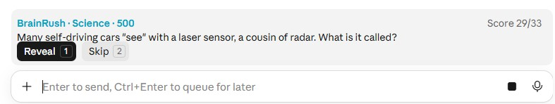
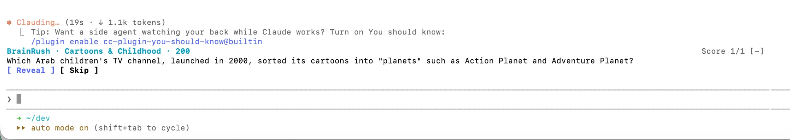
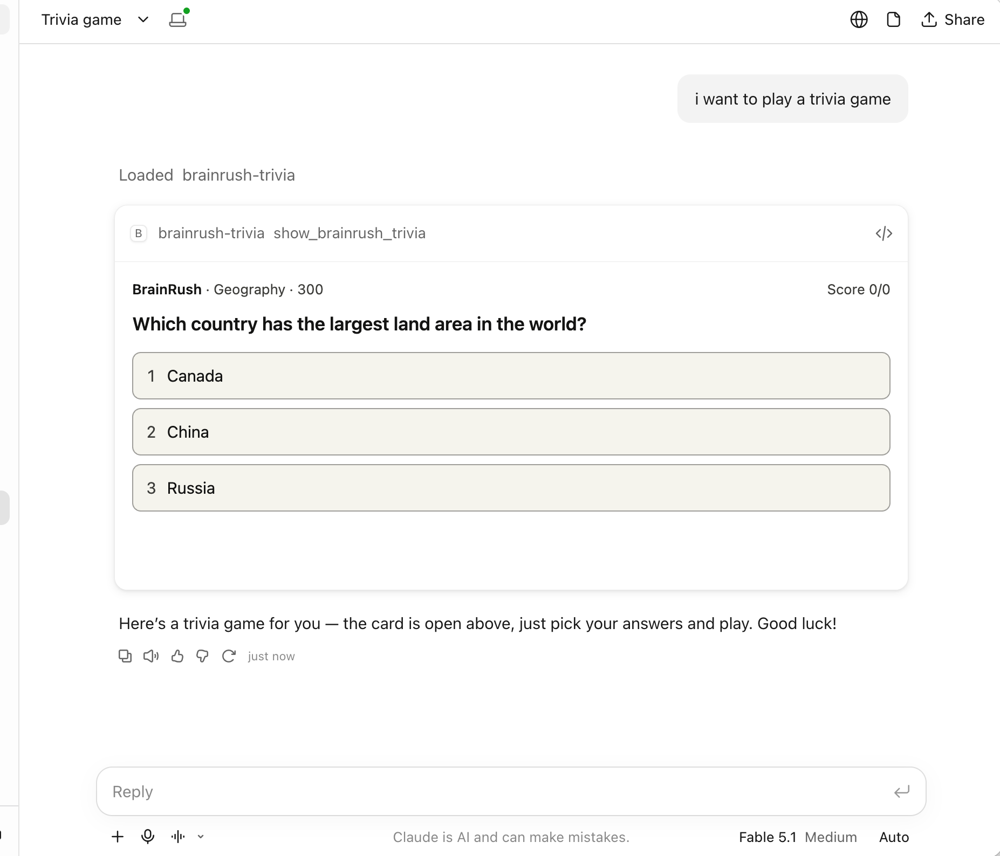

# BrainRush trivia for Claude

[BrainRush](https://brainrush.integration.ninja/index.html) trivia while you wait for Claude. One plugin, two parts:

- **In Claude Code** (terminal and the desktop app's Code tab): a band above the prompt shows questions while Claude is working, so the wait is a quiz instead of idle time.
- **In Chat and Cowork** (claude.ai, the desktop app, mobile): the BrainRush Trivia connector. Ask Claude for BrainRush trivia and a multiple-choice card opens in the conversation.

## Claude Code: the band above the prompt

- The band appears while a turn runs (subagents inside the turn included) and hides when Claude is done.
- Click the band (or press ctrl+x tab), then **1** Reveal / **2** Skip; after revealing, **1** Got it / **2** Missed.
- Questions come live from the BrainRush site's public API (text questions only). Questions you have seen are sent back so they don't repeat. Your score and seen list stay on your machine.
- `/trivia` shows your score; `/trivia off`, `/trivia on`, `/trivia reset`.

Needs a recent Claude Code and internet access to the BrainRush site.

**What it looks like**

**Claude Code desktop app (Code tab): the band above the prompt box.** While Claude is thinking or working, a question shows just above the prompt box, with **Reveal** (1) and **Skip** (2). After revealing, **Got it** (1) or **Missed** (2) scores it.



**Claude Code in the terminal: the band above the prompt.** While Claude works, a question shows just above the prompt. Click the band (or press ctrl+x tab), then **1** Reveal or **2** Skip. `[-]` folds the band away.




## Chat and Cowork: the trivia card

The plugin includes the BrainRush Trivia connector (`https://brainrush.integration.ninja/api/mcp.php`, no sign-in). Once it is connected, ask for example "Let's play BrainRush trivia". The first time, Claude asks to show the card: choose **Allow**.

- Each question has 3 answers, some have a picture (flags, landmarks). Tap an answer, or press **1** to **3**, to see right or wrong, then **Next question** (or Enter).
- The card keeps a score while it is open and never repeats a question in the same card.
- The card opens when you ask for it. Chat and Cowork have no place for a band while Claude works, so that part is Claude Code only.

In Claude Code the connector loads too, but Claude Code shows no cards: asking for trivia there gets a short text reply. The band is the Claude Code experience.

**What it looks like**

**Chat: the trivia card.** Ask for a trivia game and Claude opens the card in the conversation. Tap an answer (or press 1 to 3) to see right or wrong; your score is at the top right.



## Does it use tokens?

**The band in Claude Code: no.** The model never sees the questions:

- Questions are fetched from the BrainRush site over plain HTTP, not generated by the model.
- The band, buttons and score are drawn locally by Claude Code.
- Your score and seen questions are saved on your own machine.

The mod never calls the model, never writes into the conversation, and doesn't change the system prompt. Revealing, skipping and scoring only redraw the band. The one small exception is the `/trivia` command: its reply (such as "BrainRush trivia is on. Score: 12/17.") is added to the conversation, and the model reads it with your next message. That costs a few tokens each time you run it.

**The card in Chat and Cowork: a few.** Opening it is a tool call whose result is one short sentence; the questions and answers are not in it. The card then loads its questions through its own tool calls, which go from the card to the BrainRush site through Claude's app. The MCP Apps specification doesn't say whether an app ever shows those calls to the model, so "no tokens while playing" is likely but not guaranteed. With the connector loaded, its two tools are also listed among Claude's available tools.

## Install

**Chat and Cowork** (claude.ai or the desktop app): use one of the two ways below, not both, or you get the same tools twice.

*Option A: install the plugin* (the connector, plus the band in Claude Code through plugin sync):

1. Go to **Customize > Plugins > Add > Add marketplace** and enter `ahmedfahim89/brainrush-trivia-claude-mod`.
2. Install **BrainRush Trivia**.
3. Open the plugin's **Connectors** tab and connect **brainrush-trivia**.

On Team and Enterprise plans an Owner may have to make the plugin or the connector available first. A plugin installed on your account also reaches Claude Code as a synced plugin at the next session start.

*Option B: add only the connector by its URL* (Chat and Cowork only, no plugin):

On a Free, Pro, Max or Ultra plan:

1. Go to **Customize > Connectors**.
2. Click **Add custom connector**.
3. Name it `BrainRush Trivia` and enter the URL `https://brainrush.integration.ninja/api/mcp.php`.
4. The server needs no sign-in: leave the OAuth fields under **Advanced settings** empty, or choose **No sign-in** if the dialog asks how people authenticate.
5. Click **Add**.

The Free plan allows one custom connector.

On a Team or Enterprise plan, members can't add a custom connector themselves:

1. An Owner goes to **Organization settings > Connectors**, selects **Add**, then **Custom** (type **Web** if asked), enters the URL above, chooses no sign-in, and clicks **Add**.
2. Each member then goes to **Customize > Connectors**, finds **BrainRush Trivia** with the **Custom** label, and clicks **Connect**.

**Play:** in a chat, click **+**, select **Connectors** and check that BrainRush Trivia is on. Then ask "Let's play BrainRush trivia". The first time, Claude asks to show the card: choose **Allow** (or **Always allow**). To remove it later, go to **Customize > Connectors** and click **Remove**.

**Claude Code**, at the prompt of a terminal session:

```
/plugin install brainrush-trivia --marketplace ahmedfahim89/brainrush-trivia-claude-mod
```

Answer `y` to add the marketplace, then pick a scope (user scope loads it in every session).

From a shell:

```
claude plugin install brainrush-trivia --marketplace ahmedfahim89/brainrush-trivia-claude-mod
```

In the desktop app's Code tab, where `/plugin` does not run: click **+** next to the prompt box, then **Plugins**, **Add marketplace** with `ahmedfahim89/brainrush-trivia-claude-mod`, then **Add plugin**.

## Develop

`claude plugin validate .` and `claude plugin test .` check the mod; the code is `hooks/register.tsx`. The connector points at `.mcp.json`; its server and card live in the BrainRush repository (`api/mcp.php`, `mcp/trivia-card.html`).
